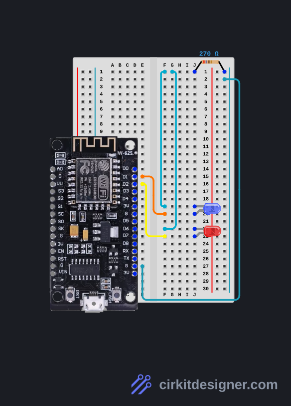

# Mini-BIBIFI IoT: Segurança no Desenvolvimento com NodeMCU ESP8266

Atividade prática de **30 a 45 minutos** baseada no artigo [*Understanding the How and the Why: Exploring Secure Development Practices through a Course Competition*](docs/Understanding%20the%20How%20and%20the%20Why%20-%20Exploring%20Secure%20Development%20Practices%20through%20a%20Course%20Competition.pdf) (Fulton et al., ACM CCS '22), adaptada para a metodologia **BIBIFI (*Build It, Break It, Fix It*)** usando uma **NodeMCU ESP8266** e LEDs em rede Wi-Fi própria.

---

## Objetivo do Projeto

Simular em sala de aula o ciclo real de desenvolvimento, ataque e correção de um **Controlador Smart Home IoT** (onde um **LED Azul** representa a luz principal da casa e um **LED Vermelho** representa o alarme de segurança).

O experimento reproduz na prática as três descobertas centrais do artigo:
1. **Fase Build It (15 min):** Os colegas recebem um firmware incompleto e implementam regras de controle de acesso (`admin` vs. `visitante`), deixando naturalmente brechas simples de código (**Mistake** e **Some Intuitive No Implementation**).
2. **Fase Break It — Rodada 1 (7 min):** O grupo aplicador (Red Team) explora essas brechas via Wi-Fi para **apagar a luz (LED Azul)** sem saber a senha, e explica onde está o erro.
3. **Fase Fix It (8 min):** Os colegas corrigem os bugs e passam a exigir um **Token Hash MD5** (`MD5(usuario:senha:acao)`) para autenticar o `admin`.
4. **Fase Break It — Rodada 2 / Replay Attack (5 min):** Mesmo após o *Fix*, o grupo aplicador intercepta um comando legítimo do `admin` e executa uma **replicação de comando (*Replay Attack*)**, apagando o LED Azul novamente sem conhecer a senha — comprovando o que o artigo chama de **Misunderstanding** + **Unintuitive No Implementation** (ausência de *Nonce* de uso único).
5. **Fechamento (5 min):** Demonstração da solução definitiva com **Nonce dinâmico** e conexão com os resultados do artigo (incluindo o paralelo com o protocolo **ESP-NOW**).

---

## Como Ler a Documentação (Ordem Recomendada)

Se você é do **grupo aplicador**, siga esta ordem antes da aula:

1. **Primeiro — Este `README.md`:** Para entender a visão geral e quais arquivos entregar aos colegas.
2. **Segundo — [`docs/3_guia_do_seu_grupo_e_circuito.md`](docs/3_guia_do_seu_grupo_e_circuito.md):** Seu manual prático com a montagem na protoboard, o cronograma minuto a minuto, o funcionamento exato das brechas e os comandos de ataque.
3. **Terceiro — [`docs/2_enunciado_para_os_colegas.md`](docs/2_enunciado_para_os_colegas.md):** Leia a folha que será entregue aos colegas para saber exatamente o que eles terão de informação.
4. **Quarto — [`docs/1_analise_artigo_e_fundamentacao.md`](docs/1_analise_artigo_e_fundamentacao.md):** Use como base teórica para apresentar ao professor a relação entre o artigo científico (em `docs/`) e o exercício.

---

## Mapa de Arquivos: O Que Usar e Quem Recebe o Quê

> **Regra de ouro:** **NÃO** entregue a pasta `ataques/`, os gabaritos `2_`, `3_`, `4_` nem os guias secretos `1_` e `3_` para os colegas antes do final da aula!

### 1. Arquivos para ENTREGAR aos Colegas (Somente estes 2!)

| Arquivo | Para que serve |
| :--- | :--- |
| [`docs/2_enunciado_para_os_colegas.md`](docs/2_enunciado_para_os_colegas.md) | Folha de especificação com regras de negócio (`visitante` vs. `admin`), acesso às páginas `/` e `/admin` e instruções da tarefa de 15 min. |
| [`firmware/1_smarthome_esqueleto_colegas/1_smarthome_esqueleto_colegas.ino`](firmware/1_smarthome_esqueleto_colegas/1_smarthome_esqueleto_colegas.ino) | Código inicial para os colegas abrirem na Arduino IDE, completarem o bloco `// TODO` em `handleControleLuz()` e gravarem na NodeMCU. |

*(Se houver mais de um grupo de colegas na sala, peça para cada grupo alterar o `AP_SSID = "SmartHome_IoT"` para `"SmartHome_Equipe1"`, `"SmartHome_Equipe2"`, etc.)*

### 2. Arquivos Exclusivos do Seu Grupo (Aplicadores / Red Team)

| Arquivo | Para que serve |
| :--- | :--- |
| [`docs/3_guia_do_seu_grupo_e_circuito.md`](docs/3_guia_do_seu_grupo_e_circuito.md) | Roteiro completo da dinâmica, explicação das 3 vulnerabilidades e cola de comandos. |
| [`docs/1_analise_artigo_e_fundamentacao.md`](docs/1_analise_artigo_e_fundamentacao.md) | Análise das RQs do artigo de Fulton et al. (CCS '22) e paralelo técnico entre HTTP e ESP-NOW. |
| [`ataques/painel_ataque_grupo.py`](ataques/painel_ataque_grupo.py) | Painel interativo de terminal para rodar no notebook (Linux/Windows/macOS) e executar o **Break 1** e o **Break 2 (Replay Attack)**. |
| [`ataques/cliente_admin.py`](ataques/cliente_admin.py) | Simula o aplicativo oficial do Administrador enviando comandos autenticados por Token MD5. |
| [`firmware/2_smarthome_pos_fix_colegas/2_smarthome_pos_fix_colegas.ino`](firmware/2_smarthome_pos_fix_colegas/2_smarthome_pos_fix_colegas.ino) | **Gabarito Pós-Fix:** código já corrigido contra o Break 1, mas vulnerável ao **Replay Attack** (útil caso alguma equipe não termine o *Fix* a tempo). |
| [`firmware/3_smarthome_seguro_com_nonce/3_smarthome_seguro_com_nonce.ino`](firmware/3_smarthome_seguro_com_nonce/3_smarthome_seguro_com_nonce.ino) | **Solução Final:** implementação com **Nonce de uso único** que bloqueia o Replay Attack. |
| [`firmware/4_placa_atacante_redteam/4_placa_atacante_redteam.ino`](firmware/4_placa_atacante_redteam/4_placa_atacante_redteam.ino) | **Opcional:** permite usar uma segunda NodeMCU (apertando o botão `FLASH`) para disparar os ataques no lugar do notebook. |
| [`docs/Understanding the How and the Why - Exploring Secure Development Practices through a Course Competition.pdf`](docs/Understanding%20the%20How%20and%20the%20Why%20-%20Exploring%20Secure%20Development%20Practices%20through%20a%20Course%20Competition.pdf) | Artigo científico original que fundamenta o trabalho. |

---

## Montagem de Hardware (Apenas NodeMCU + 2 LEDs)

Não é necessário usar módulo Relé nem Sensor de Som. O circuito usa apenas a **NodeMCU ESP8266** com 2 LEDs e resistor(es) limitador(es) de corrente:



- **LED Azul (`D1` / GPIO 5):** Luz Principal da Casa (inicia **ACESA** ao ligar a placa).
- **LED Vermelho (`D2` / GPIO 4):** Alarme de Segurança (acende por **3 segundos** após tentativa de acesso negado ou login inválido e apaga automaticamente).

---

## Como Gravar e Testar (Passo a Passo Rápido)

### 1. Gravar o Firmware na NodeMCU (Arduino IDE)
- **Placa:** `NodeMCU 1.0 (ESP-12E Module)` (pacote `esp8266 by ESP8266 Community`).
- **Bibliotecas:** Apenas bibliotecas nativas do core ESP8266 (`ESP8266WiFi.h`, `ESP8266WebServer.h`, `MD5Builder.h`).
- **Monitor Serial:** `115200 baud`.
- *(Linux/Fedora: caso dê `Permission denied` na porta `/dev/ttyUSB0`, adicione seu usuário ao grupo `dialout` com `sudo usermod -aG dialout $USER` e refaça o login.)*

### 2. Conectar na Rede da Placa
- **SSID:** `SmartHome_IoT`
- **Senha:** `12345678`
- **Página do Convidado:** `http://192.168.4.1/`
- **Página do Administrador (Login):** `http://192.168.4.1/admin` *(usuário: `admin`, senha: `seguranca2026`)*

### 3. Executar os Scripts no Notebook (Python 3 padrão, sem dependências externas)

Abrir o painel interativo de ataques do seu grupo (`sudo` permite que o sniffer `tcpdump` capture pacotes reais na interface de rede):
```bash
sudo python3 ataques/painel_ataque_grupo.py
```

Simular o Administrador apagando a luz legitimamente (gera o pacote com Token MD5 na rede para o Replay Attack):
```bash
python3 ataques/cliente_admin.py OFF
```
